  

Desarrollador con experiencia en Salesforce y tecnologías web modernas. En el día a día trabajo con Apex y LWC; en mi tiempo libre construyo aplicaciones web completas con **Next.js, React, TypeScript y Supabase**, desde la base de datos hasta la PWA instalable en el móvil.

---

## 🚀 Proyectos Destacados

### [💸 Submana](https://github.com/Diego-Mardomingo/Submana) · [Abrir app →](https://submana.vercel.app)

App de finanzas personales: subes el extracto del banco y Submana crea los movimientos, detecta duplicados y transferencias entre tus cuentas, y te enseña en qué se va el dinero.

**Features:** importación de extractos (Trade Republic, Revolut, BBVA, Imagin), control de suscripciones, presupuestos por categoría, gastos compartidos con amigos y cuentas conjuntas, dashboard con previsión de gasto, notificaciones push  
**Stack:** Next.js · React · TypeScript · Tailwind CSS · Supabase · PWA · Vercel

### [🎧 Ecos](https://github.com/Diego-Mardomingo/Ecos) · [Jugar →](https://ecosgame.vercel.app)

Juego diario de adivinar canciones: cada día hay una canción misteriosa y escuchas fragmentos cada vez más largos (de 1 a 30 segundos) hasta acertarla.

**Features:** ranking global, semanal y mensual en tiempo real, archivo de retos pasados, login con Google, modo invitado, ES/EN, tema claro/oscuro, avisos push  
**Stack:** Next.js · React · TypeScript · Tailwind CSS · Supabase · Python + GitHub Actions · PWA · Vercel

### [🎮 HubGames](https://github.com/Diego-Mardomingo/HubGames) · [Abrir app →](https://hub-games.vercel.app)

Biblioteca gamer con buscador integrado con Steam (Web API, Store API y SteamSpy), fichas completas de cada juego y **JUDI**, un minijuego diario estilo Wordle para adivinar el videojuego del día con el menor número de pistas.

**Features:** filtros avanzados, galerías y puntuaciones Metacritic, reto diario, ranking global  
**Stack:** Next.js · React · TypeScript · Tailwind CSS · Supabase · PWA · Vercel

### [❯ OhMyPosh-Theme](https://github.com/Diego-Mardomingo/OhMyPosh-Theme)

Mi tema de Oh My Posh para PowerShell: minimalista, con paleta Catppuccin Mocha, info de Git de un vistazo y prompt transitorio.

---

## 💼 Experiencia Técnica

**Salesforce Development**
- Desarrollo con Apex y Lightning Web Components (LWC)
- Implementación de soluciones personalizadas en Salesforce
- Control de versiones con Git y gestión ágil con Jira
- Metodología Scrum

**Web Development**
- Frontend: React, Next.js, TypeScript, Tailwind CSS
- Backend: Node.js, Supabase (PostgreSQL, Auth, Realtime), PHP, Java
- Bases de datos: PostgreSQL, MySQL, Oracle, MariaDB
- Apps instalables (PWA) con notificaciones push y despliegue en Vercel

---

## 🛠️ Tech Stack

**Frontend**  

**Backend & Databases**  

**Salesforce**  

**Tools & Others**  

---

## 📫 Contacta Conmigo

